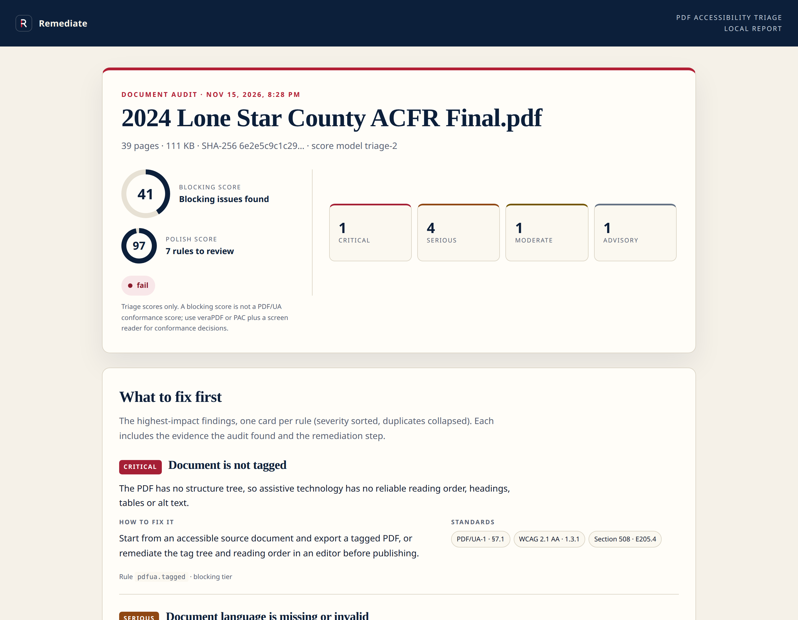

# pdf-a11y-audit

**A local-first PDF accessibility auditor for people and AI agents.**

No upload. No account. No API key. No model call. It reads a local PDF, inspects
the actual object model and text layer, and returns a compact summary, a JSON
report, a Markdown audit, CSV or SARIF output, or a self-contained HTML report
you can send to a colleague.

It is heuristic triage, not a PDF/UA validator. Use veraPDF or PAC plus a screen
reader before making a conformance claim.

[](docs/report-preview.png)

## Why this exists

Most PDF accessibility checks are either a Windows GUI, a paid service, or a
black-box score. This tool is the opposite:

- **Local:** the document never leaves the machine.
- **Deterministic:** the same PDF produces the same findings.
- **Evidence-based:** every finding names the rule, the page, the standards
  reference and the remediation step.
- **Honest:** checks that need a screen reader or a human are listed as
  manual, never reported as passed.
- **Free:** no server, no per-document fee, no inference cost.

It is built and maintained by [Remediate](https://remediatepdf.com/pdf-remediation?utm_source=pdf-a11y-audit&utm_medium=readme)
for teams publishing public-sector documents.

## Requirements

- Node.js **22.13 or newer**. `pdfjs-dist` needs 22.13 as its floor.
- No account, network access or model provider. The CLI and the MCP server work
  offline.

## Install

```bash
# Run without installing
npx -y pdf-a11y-audit ./document.pdf

# Or install the CLI
npm install -g pdf-a11y-audit
pdf-a11y-audit ./document.pdf --format html --out report.html
```

Published on npm as
[`pdf-a11y-audit`](https://www.npmjs.com/package/pdf-a11y-audit) and listed in
the official MCP Registry as `io.github.Veduis/pdf-a11y-audit`.

Prefer to work from a checkout? Clone the repository, run `npm install`, and
use `node bin/cli.js` instead.

## CLI

```bash
# Markdown to the terminal
pdf-a11y-audit budget.pdf

# A compact summary instead of the full report
pdf-a11y-audit budget.pdf --format summary

# A self-contained HTML report (one document at a time)
pdf-a11y-audit budget.pdf --format html --out budget-a11y.html

# JSON for a pipeline
pdf-a11y-audit budget.pdf --format json --out budget-a11y.json

# SARIF for code scanning, or CSV for a spreadsheet
pdf-a11y-audit budget.pdf --format sarif --out budget-a11y.sarif
pdf-a11y-audit ./public-docs --format csv

# Only report serious and critical findings
pdf-a11y-audit budget.pdf --severity serious

# Fail a build on serious or critical findings
pdf-a11y-audit budget.pdf --fail-on serious

# Compare against a saved baseline, or write the current report as the baseline
pdf-a11y-audit budget.pdf --baseline budget-baseline.json
pdf-a11y-audit budget.pdf --update-baseline budget-baseline.json

# Only the summary line
pdf-a11y-audit budget.pdf --quiet

# Start the MCP server on stdio
pdf-a11y-audit --mcp
```

| Option | Default | Meaning |
|---|---|---|
| `--format json\|markdown\|summary\|html\|csv\|sarif` | `markdown` | Output format |
| `--out <path>` | stdout, or `<name>-a11y-report.html` for HTML | Write to a file |
| `--severity <level>` | all findings | Only include findings at or above this severity |
| `--fail-on <severity\|none>` | `serious` | Exit 1 at or above this severity |
| `--max-findings <n>` | `500` | Cap findings shown per document. Display only: scores and status come from all findings. |
| `--baseline <file>` | off | Compare the current report against a saved baseline |
| `--update-baseline <file>` | off | Write the current findings as the new baseline |
| `--quiet` | off | Print only the summary line |
| `--mcp` | off | Start the stdio MCP server instead of the CLI |
| `--help`, `--version` | | Print help or the version |

`--fail-on` defaults to `serious`, which means a normal report run on most real
documents exits `1`. That is deliberate for a CI gate; pass `--fail-on none`
when the report itself is the deliverable.

The HTML report is one document at a time. Use `render_report` or run the CLI
once per file when you need HTML for a folder.

## MCP server

The package exposes a stdio MCP server. It never opens a network connection.
Every tool declares an `outputSchema`, so a client can validate the structured
result.

### Claude Desktop / Cursor / any MCP client

```json
{
  "mcpServers": {
    "pdf-a11y-audit": {
      "command": "npx",
      "args": ["-y", "pdf-a11y-audit", "--mcp"]
    }
  }
}
```

For a local checkout:

```json
{
  "mcpServers": {
    "pdf-a11y-audit": {
      "command": "node",
      "args": ["/absolute/path/to/pdf-a11y-audit/bin/mcp.js"]
    }
  }
}
```

A minimal client is included. It starts the server, calls `audit_pdf` and prints
the result exactly as the server returned it:

```bash
node examples/mcp-client.mjs ./document.pdf
MCP_TRACE=1 node examples/mcp-client.mjs ./document.pdf | head -n 30
```

The same server can be started through the CLI entry point with `--mcp`; this is
the form used by the registry manifest and by the `npx` configuration above.

### Tools

| Tool | What it does |
|---|---|
| `audit_pdf` | Audit one local PDF. Formats: `json`, `markdown`, `html`, `summary` (default). `minSeverity` filters findings, `maxFindings`/`offset` paginate the returned list, and `overwrite: true` is required to replace an existing output file. |
| `audit_batch` | Audit every PDF under one or more folders. Formats: `json`, `markdown`, `csv`. File count and folder depth are capped, symlinked PDFs are followed with loop protection, and one unreadable file fails soft instead of aborting the batch. |
| `explain_finding` | Explain a rule, its standards mapping and its remediation. |
| `list_checks` | List the automated and manual check catalog. |
| `compare_reports` | Compare two reports for the same document and list new, fixed and persisting findings. Cross-document comparisons are refused. |
| `render_report` | Re-render an existing JSON report as HTML and write the file. `overwrite: true` is required to replace an existing file. |

File-writing tools refuse to replace an existing file unless `overwrite: true`
is passed. Relative paths resolve against the server process working
directory, so absolute paths are safer.

### Resources and prompt

- `remediate://rules`: the full rule catalog.
- `remediate://methodology`: what the audit can and cannot decide.
- `audit_and_plan`: a prompt that turns findings into a prioritized remediation
  plan without claiming conformance.

## What it checks

There are **62 automated checks** and **10 manual checks**. The automated engine
covers, among other things:

- **Document:** tagging, `/MarkInfo`, parent tree, suspects, role map, language,
  display title, document title, XMP title, PDF/UA claims.
- **Headings:** presence, first level, skipped levels, empty headings, multiple H1s.
- **Tables:** header cells, empty headers, `Scope`/`Headers`, rows, irregular rows.
- **Figures:** missing alt, empty alt, filename-like alt.
- **Forms:** field names, tooltips, duplicate names, widget structure, tab order.
- **Lists:** empty list items.
- **Links:** structure parent and accessible names.
- **Fonts:** embedded fonts and `ToUnicode` maps.
- **Pages:** scanned pages, blank pages, sparse text.
- **Reading order:** orphaned or missing MCIDs and order mismatches.
- **Navigation:** missing bookmarks in long documents, empty bookmark entries.

The report also lists **10 manual checks** for colour contrast, alt-text
quality, screen-reader order, complex tables, link purpose, OCR accuracy, form
errors and a full assistive-technology pass. An automated pass is not a
conformance certificate, and the tool is not a substitute for veraPDF, PAC or a
screen reader.

## The report

Every report carries two 0-100 scores and a status:

- `blockingScore`: PDF/UA-critical and serious findings.
- `polishScore`: moderate and advisory findings.
- `status`: `fail`, `review` or `pass`.

`summary.score` is the blocking score. The scores are computed from every
finding before any display cap, so asking for less output cannot improve them.
Findings are grouped per root cause, and page-level findings are counted so a
long document is not penalised just for having more pages. Advisory findings can
never round a report to 100.

The HTML report is a single file with no external fonts, images, scripts or
tracking. It includes:

- the status, both scores and the scoring method;
- a "Findings by rule" rollup;
- "What to fix first", deduplicated by rule;
- evidence and remediation for every finding;
- the standards mapping;
- the full automated check register (all 62, including skipped checks);
- the manual review checklist and limitations;
- a machine-readable JSON copy of the report in a `<script type="application/json">`
  block.

It is responsive, print-friendly and supports light and dark colour schemes.

## Design principles

- **No recurring cost.** No hosted service, no inference, no storage, no account.
- **No AI theatre.** No purple gradients, glowing blobs or "AI-powered" copy.
  The report is an editorial document, not a dashboard toy.
- **Evidence over scores.** The scores are a summary with a stated method; the
  findings are the product.
- **Fail visibly, not silently.** Unsupported checks are reported as skipped or
  manual; they are never silently treated as passes.

## Development

```bash
cd pdf-a11y-audit
npm install
npm test
```

The test suite generates its own tagged and untagged PDF fixtures, exercises
the CLI and MCP server, and verifies the HTML report is self-contained.

Vulnerability reports: see `SECURITY.md` in the public repository for the
disclosure process.

## Limitations

- The audit reads the PDF, not a customer's website or third-party embeds.
- This is heuristic triage, not a PDF/UA validator. Use veraPDF or PAC plus a
  screen reader before making a conformance claim.
- Colour contrast, alt-text quality and the meaning of the reading order require
  a human and a screen reader.
- Malformed or encrypted PDFs can hide structure from any parser.
- This is not legal advice and not a conformance certificate.

## License

MIT © Veduis. Built by [Remediate](https://remediatepdf.com/pdf-remediation?utm_source=pdf-a11y-audit&utm_medium=readme).
