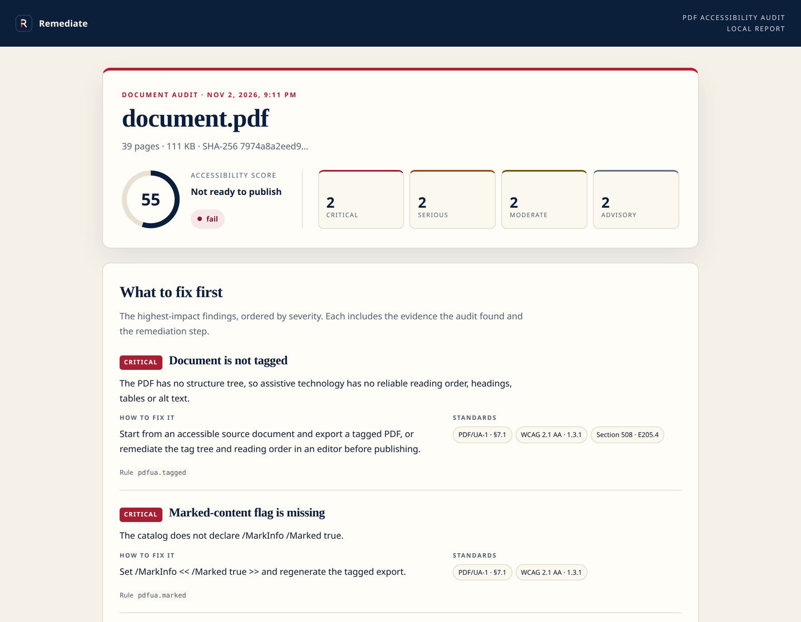

# pdf-a11y-audit

**A local-first PDF accessibility auditor for people and AI agents.**

No upload. No account. No API key. No model call. It reads a local PDF, inspects
the actual object model and text layer, and returns a structured report, a
Markdown audit, or a self-contained HTML report you can send to a colleague.

[](docs/report-preview.png)

## Why this exists

Most PDF accessibility checks are either a Windows GUI, a paid service, or a
black-box score. This tool is the opposite:

- **Local** — the document never leaves the machine.
- **Deterministic** — the same PDF produces the same findings.
- **Evidence-based** — every finding names the rule, the page, the standards
  reference and the remediation step.
- **Honest** — checks that need a screen reader or a human are listed as
  manual, never reported as passed.
- **Free** — no server, no per-document fee, no inference cost.

It is built and maintained by [Remediate](https://remediatepdf.com/pdf-remediation?utm_source=pdf-a11y-audit&utm_medium=readme)
for teams publishing public-sector documents.

## Install

The npm release is pending. Until it is published, run the auditor from a
local checkout:

```bash
git clone https://github.com/Veduis/pdf-a11y-audit.git
cd pdf-a11y-audit
npm install
node bin/cli.js ./document.pdf
```

After publication, the same package will run without a checkout:

```bash
npx -y pdf-a11y-audit ./document.pdf
npm install -g pdf-a11y-audit
pdf-a11y-audit ./document.pdf --format html --out report.html
```

## CLI

```bash
# Markdown to the terminal
pdf-a11y-audit budget.pdf

# A self-contained HTML report
pdf-a11y-audit budget.pdf --format html --out budget-a11y.html

# JSON for a pipeline
pdf-a11y-audit budget.pdf --format json --out budget-a11y.json

# Fail a build on serious or critical findings
pdf-a11y-audit budget.pdf --fail-on serious

# Audit every PDF in a folder
pdf-a11y-audit ./public-docs --format csv
```

| Option | Default | Meaning |
|---|---|---|
| `--format json\|markdown\|html\|csv` | `markdown` | Output format |
| `--out <path>` | stdout, or `<name>-a11y-report.html` for HTML | Write to a file |
| `--fail-on <severity\|none>` | `serious` | Exit 1 at or above this severity |
| `--max-findings <n>` | `500` | Cap findings per document |
| `--quiet` | off | Print only the final summary |

## MCP server

The package exposes a stdio MCP server. It never opens a network connection.

### Claude Desktop / Cursor / any MCP client

```json
{
  "mcpServers": {
    "pdf-a11y-audit": {
      "command": "npx",
      "args": ["-y", "pdf-a11y-audit", "--mcp"]
    }
  }
}
```

For a local checkout:

```json
{
  "mcpServers": {
    "pdf-a11y-audit": {
      "command": "node",
      "args": ["/absolute/path/to/pdf-a11y-audit/bin/mcp.js"]
    }
  }
}
```

A minimal client is included. It starts the server, calls `audit_pdf` and prints
the result exactly as the server returned it:

```bash
node examples/mcp-client.mjs ./document.pdf
MCP_TRACE=1 node examples/mcp-client.mjs ./document.pdf | head -n 30
```

The same server can be started through the CLI entry point with `--mcp`; this is
the form used by the registry manifest and by the `npx` configuration above.


### Tools

| Tool | What it does |
|---|---|
| `audit_pdf` | Audit one local PDF. Returns JSON, Markdown or a self-contained HTML report; `output` writes a file. |
| `audit_batch` | Audit every PDF in one or more folders and return a comparison table. |
| `explain_finding` | Explain a rule, its standards mapping and its remediation. |
| `list_checks` | List the rule catalog, including manual checks. |
| `compare_reports` | Compare two JSON reports and list new, fixed and persisting findings. |
| `render_report` | Re-render an existing JSON report as HTML and write the file. |

### Resources and prompt

- `remediate://rules` — the full rule catalog.
- `remediate://methodology` — what the audit can and cannot decide.
- `audit_and_plan` — a prompt that turns findings into a prioritized remediation
  plan without claiming conformance.

## What it checks

The automated engine covers:

- **Document:** tagging, `/MarkInfo`, parent tree, suspects, role map, language,
  display title, document title, XMP title, PDF/UA claims.
- **Headings:** presence, first level, skipped levels, empty headings, multiple H1s.
- **Tables:** header cells, empty headers, `Scope`/`Headers`, rows, irregular rows.
- **Figures:** missing alt, empty alt, filename-like alt.
- **Forms:** field names, tooltips, duplicate names, widget structure, tab order.
- **Lists:** empty list items.
- **Links:** structure parent and accessible names.
- **Fonts:** embedded fonts and `ToUnicode` maps.
- **Pages:** scanned pages, blank pages, sparse text.
- **Reading order:** orphaned or missing MCIDs and order mismatches.
- **Navigation:** missing bookmarks in long documents, empty bookmark entries.

The report also lists **manual checks** for colour contrast, alt-text quality,
screen-reader order, complex tables, link purpose, OCR accuracy, form errors and
a full assistive-technology pass. An automated pass is not a conformance
certificate.

## The HTML report

The HTML report is a single file with no external fonts, images, scripts or
tracking. It includes:

- an accessibility score and severity counts;
- the highest-impact findings first;
- evidence and remediation for every finding;
- the standards mapping;
- the full automated check register, including skipped checks;
- the manual review checklist and limitations;
- a machine-readable JSON copy of the report in a `<script type="application/json">`
  block.

It is responsive, print-friendly and supports light and dark colour schemes.

## Design principles

- **No recurring cost.** No hosted service, no inference, no storage, no account.
- **No AI theatre.** No purple gradients, glowing blobs or “AI-powered” copy.
  The report is an editorial document, not a dashboard toy.
- **Evidence over scores.** The score is a summary; the findings are the product.
- **Fail visibly, not silently.** Unsupported checks are reported as skipped or
  manual; they are never silently treated as passes.

## Development

```bash
cd pdf-a11y-audit
npm install
npm test
```

The test suite generates its own tagged and untagged PDF fixtures, exercises
the CLI and MCP server, and verifies the HTML report is self-contained.

## Limitations

- The audit reads the PDF, not a customer's website or third-party embeds.
- Colour contrast, alt-text quality and the meaning of the reading order require
  a human and a screen reader.
- Malformed or encrypted PDFs can hide structure from any parser.
- This is not legal advice and not a conformance certificate.

## License

MIT © Veduis. Built by [Remediate](https://remediatepdf.com/pdf-remediation?utm_source=pdf-a11y-audit&utm_medium=readme).
